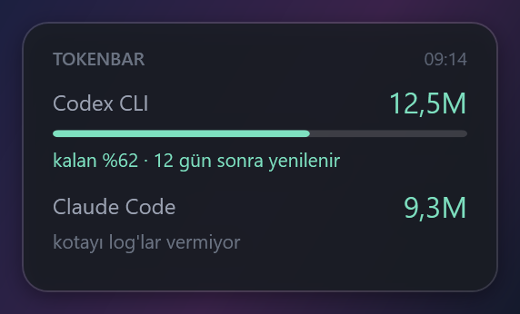
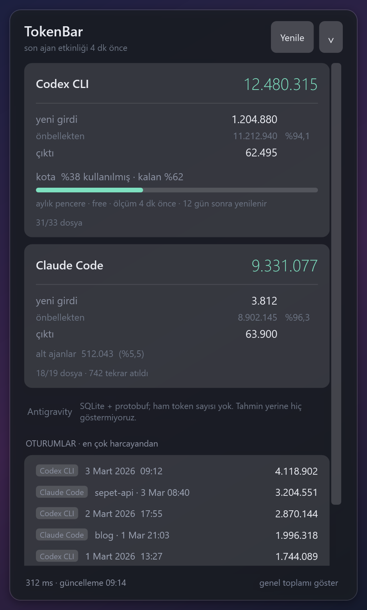

# TokenBar

Windows masaüstünde duran, bilgisayarındaki **AI kodlama ajanlarının token
kullanımını** gösteren küçük bir uygulama. Veriyi ajanların kendi **yerel log
dosyalarından** okur — hiçbir yere bağlanmaz.

> *A small Windows tray app that reports how many tokens your local AI coding
> agents have used. It reads the agents' own log files on disk and never makes
> a network request. UI and code comments are in Turkish.*

<p align="center">
  
  &nbsp;&nbsp;
  
</p>

*Ekran görüntülerindeki sayılar örnektir.*

---

## Ne yapıyor

Masaüstünde yarı saydam bir rozet duruyor; **tıklayınca** detay paneli açılıyor.
Aynı anda sistem tepsisinde de bir ikon var, üstünde toplam yazıyor.

| Ajan | Durum | Not |
|---|---|---|
| **Codex CLI** | ✅ okunuyor | kota yüzdesi dahil |
| **Claude Code** | ✅ okunuyor | alt ajan (subagent) ayrımıyla |
| **Antigravity** | ⚠️ okunmuyor | *bilerek* — aşağıya bak |

Ek olarak:

- Kendi kendine yenileniyor (2–30 dk, kullanım yoğunluğuna göre)
- Kota **kalan** yüzdesi ve ne zaman yenileneceği
- En çok harcayan oturumların listesi
- Windows açılışında başlatma seçeneği
- Rozetin konumu hatırlanıyor

---

## Kurulum

Gereken: **.NET 10 SDK** (Windows).

```powershell
git clone <bu-repo>
cd tokenbar
dotnet publish tokenbar\tokenbar.csproj -c Release
```

Üretilen `tokenbar\bin\Release\net10.0-windows\publish\tokenbar.exe` dosyasını
çalıştır. İstersen masaüstüne kısayol koy.

Konsol sürümü — sayıları doğrulamak için:

```powershell
dotnet run --project src\TokenBar.Cli
dotnet run --project src\TokenBar.Cli -- --detail   # oturum oturum
```

### ⚠️ Smart App Control

Windows 11'de Smart App Control açıksa **yeni derlenmiş imzasız bir `.exe`
saatlerce engellenebilir.** Hata şöyle görünür:

```
System.IO.FileLoadException: ... tokenbar.dll
Uygulama Denetimi ilkesi bu dosyayı engelledi. (0x800711C7)
```

Kodda sorun yok. Ya bekle, ya SAC'ı kapat (Ayarlar → Gizlilik ve güvenlik →
Windows Güvenliği → Uygulama ve tarayıcı denetimi). **SAC'ı kapatmak geri
alınamaz** — tekrar açmak Windows'u sıfırlamayı gerektiriyor.

---

## Nasıl çalışıyor

### Okunan yollar

```
%USERPROFILE%\.codex\sessions\**\*.jsonl      (CODEX_HOME varsa o)
%USERPROFILE%\.claude\projects\**\*.jsonl     (TOKENBAR_CLAUDE_HOME varsa o)
```

Sadece `usage` / `total_token_usage` / `rate_limits` sayıları ve `message.id`
okunur. **Mesaj içeriği hiç açılmaz.** Kimlik dosyalarına dokunulmaz.

### İşin özü: normalizasyon

İki ajan aynı alan adını **taban tabana zıt** anlamda kullanıyor:

| | Codex CLI | Claude Code |
|---|---|---|
| `input_tokens` | girdinin **tamamı** | girdinin **binde 2'si** |
| önbellek alanları | `input`'un **alt kümesi** | `input`'ten **ayrık** |
| birikim | kümülatif → dosyanın son satırı | artımlı → `message.id` ile tekilleştir |

Naif çözüm iki ayrı toplam formülü yazmak olurdu. Bunun yerine ortak model üç
girdi alanını **her koşulda ayrık** tutuyor:

```csharp
// Codex — alt kümeleri ÇIKAR
InputFresh = input - cached - cacheWrite;

// Claude Code — zaten ayrık, olduğu gibi
InputFresh = input_tokens;
```

Kazanç: toplam formülü **tek**.

```csharp
public long Input => InputFresh + InputCached + CacheWrite;
public long Total => Input + Output;
```

Fark tek bir yerde (`TokenUsage.ToTotals`) duruyor; geri kalan kodun haberi yok.

### Neden Antigravity okunmuyor

Verisi var (`~\.gemini\antigravity\conversations\*.db`) ama format SQLite +
protobuf ve içinde **ham token sayısı yok** — bilinen araçlar tur sayısından
tahmin ediyor.

Uygulama "Antigravity: ≈12,3M" yazabilirdi. Yazmıyor.

> Doğrulanmamış bir tahmini kesin sayı gibi göstermek, hiç göstermemekten
> **daha kötüdür** — çünkü yanlış olduğu belli olmaz.

Onun yerine sebebi yazılıyor. `Accuracy.Estimated` modelde hazır bekliyor.

### Bayat kota gösterilmez

Kota **anlık durum**, kümülatif değil. Ajan 26 gündür çalışmadıysa elimizdeki
değer 26 günlük ve aylık pencere bu arada sıfırlanmıştır. O yüzden ölçümün
üstünden bir pencere boyu geçtiyse sayı değil **sebep** gösteriliyor.

---

## Yapı

```
src/TokenBar.Core/    bütün mantık, arayüzden bağımsız
  TokenTotals.cs        normalize model
  IUsageProvider.cs     sağlayıcı sözleşmesi
  CodexProvider.cs      kümülatif aritmetik
  ClaudeCodeProvider.cs artımlı aritmetik + tekilleştirme
  RefreshPolicy.cs      saf fonksiyon: bir sonraki tarama ne zaman
  FileCache.cs          değişmeyen dosyayı yeniden okuma
src/TokenBar.Cli/     konsol; doğrulama aracı
tokenbar/             tepsi ikonu + yüzen pencere (WPF)
```

Neden polling, neden `FileSystemWatcher` değil: olay tamponu taşınca olaylar
**sessizce** kayboluyor ve senkron klasörlerinde hiç çalışmayabiliyor. Polling
yavaş ama yanlış değil.

---

## Bilinen eksikler

- **Otomatik test yok.** En büyük eksik. `RefreshPolicy.Next` ve
  `TokenUsage.ToTotals` saf fonksiyon olarak yazıldı, test bekliyor.
- Antigravity sağlayıcısı boş (yukarıda).
- Artımlı okuma dosya bazında; satır offset'i takip edilmiyor.
- İmzalama / installer yok.

---

## Katkı ve amaç

Bu bir **öğrenme projesi**. Amacı iki katmanlı: çalışan bir uygulama, ve C# ile
Windows masaüstü geliştirmeyi gerçekten öğrenmek. Kod yorumları "ne yaptığını"
değil **"neden öyle yapıldığını"** anlatır — çünkü asıl değer orada.

## Lisans

MIT — bkz. [LICENSE](LICENSE).
